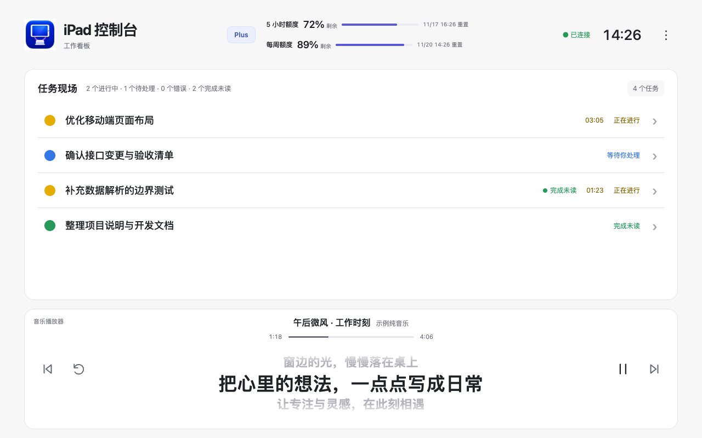
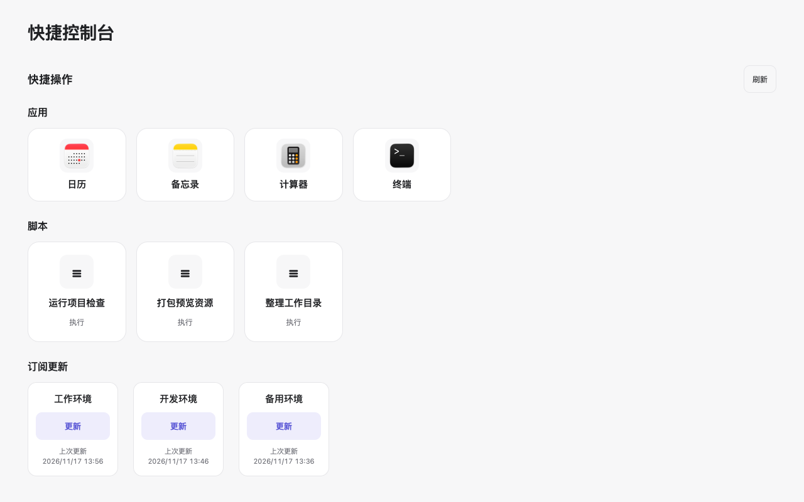

<div align="center">


# iPad 控制台

**让 iPad 成为 Mac 的第二块工作看板。**

任务进度、快捷操作、额度与音乐，在一块屏幕上随时可见。

[](https://github.com/InTheManXG/ipad-smart-dashboard/releases/latest)
[](#支持范围)
[](#支持范围)
[](LICENSE)

[下载最新版](https://github.com/InTheManXG/ipad-smart-dashboard/releases/latest) · [界面预览](#界面预览) · [配对和使用](#配对和使用) · [自托管](#自托管)

</div>

---

## 界面预览

<p align="center">
  
</p>

<p align="center"><sub>工作看板 · 截图来自当前网页界面，任务、额度和音乐均为示例数据。</sub></p>

## 能做什么

| | 功能 | 用途 |
| :---: | :--- | :--- |
| ◉ | **任务现场** | 查看 Codex 的运行、待处理和完成未读状态，按授权打开对应对话。 |
| ⌘ | **快捷控制** | 把常用应用、命令、脚本和订阅更新集中到独立控制页。 |
| ◷ | **额度信息** | 查看订阅剩余额度、重置时间和已配置中转站 Key 的用量。 |
| ♫ | **音乐与歌词** | 同步 Mac 的播放信息与歌词，按授权切歌、播放或暂停。 |
| ⇄ | **多端配对** | 使用一次性配对码连接浏览器，在 Mac 上分别管理控制权限。 |
| ◇ | **原生 Mac App** | 使用 SwiftUI 和 Swift 原生服务，本地核心功能不需要 Docker、Python 或 Homebrew。 |

<details>
<summary><strong>查看快捷控制台</strong> · 常用应用和脚本，集中在一处</summary>

<p align="center">
  
</p>

截图中的应用、脚本名称和更新记录均为示例；实际内容由你在 Mac 上配置。

</details>

## 下载发行版

当前发行版为 **0.3.18**。前往 [最新发行页](https://github.com/InTheManXG/ipad-smart-dashboard/releases/latest)，优先下载 `iPad-Control-0.3.18-unnotarized-macos-arm64.dmg`，同时下载 `SHA256SUMS` 和 `UNNOTARIZED_INSTALL.md`；ZIP 作为备用，无需同时下载。

1. 按 [安装说明](docs/UNNOTARIZED_INSTALL.md) 校验下载文件。
2. 打开 DMG，将 App 拖入“应用程序”。
3. 从“应用程序”打开，按下方步骤配对 iPad 或其他浏览器。

> 仅支持 Apple Silicon Mac，构建目标为 macOS 13+。安装包未经过 Apple 公证，系统仍可能阻止首次打开，需要用户自行确认信任。后台已知存在额度采集时偶发异常退出的问题，本版未修复，可能出现短暂掉线。

<details>
<summary>签名、构建与已验证范围</summary>

源码采用 MIT 许可证；媒体适配器单独遵循 BSD 3-Clause。Mac 安装包使用固定的 Apple Development 证书签名，以保持更新时的签名身份；这不是 Developer ID 发行签名，也没有经过 Apple 公证。GitHub 普通 Release 标记不等同 Apple 公证。

发行附件由 GitHub Actions 的 macOS runner 从版本标签编译、打包并直接上传，不使用维护者本机生成的安装包。beta.4 的[打包发布记录](https://github.com/InTheManXG/ipad-smart-dashboard/actions/runs/43840655193)已通过；后续发布入口见[发行流程](docs/RELEASE.md)。

安装包不需要 Docker、Python 或编译工具。beta.3 已在独立的 M1 Mac mini、macOS 27.0.1 上完成首次安装、配对与控制权限、版本替换保留配置及退出后台验证，详见 [实际验收记录](docs/ACCEPTANCE.md)。旧版 macOS、实际 iPad 和多播放器兼容性仍未验证；测试机原本关闭了 Gatekeeper，本次运行不代表系统安全放行通过。

</details>

## 支持范围

- Apple Silicon Mac；构建目标 macOS 13+，已在维护者当前系统及独立 M1 Mac mini 的 macOS 27.0.1 上验证，macOS 13 和其他未列出的系统版本尚未验收。
- iPad Safari、添加到主屏幕的网页，以及现代桌面浏览器。
- Codex 任务采集依赖本机 Codex App 的数据格式，后续版本变化可能需要适配。
- 音乐采集使用随包附带的 MediaRemote 兼容组件与系统 Perl。它依赖系统接口，不能保证所有 macOS 版本、播放器或歌曲都有歌词。
- 可选订阅更新由用户配置自己的脚本及解释器，沿用 `script sync [--id ID]` 协议，不内置任何订阅提供商。

## 从源码运行

安装 Apple Command Line Tools 后，在仓库目录执行：

```sh
bash mac_app/test.sh
bash mac_app/build.sh
open '.build/iPad 控制台.app'
```

默认是显式的 ad-hoc 开发构建，不需要维护者的签名证书，也不代表 Apple 验证过开发者身份。公开安装包单独标明“未公证”；如需 Apple 公证，按 [发行说明](docs/RELEASE.md) 使用 Developer ID 路径。不要关闭全局系统安全保护。

首次运行默认不连接公网、不启用局域网看板、不启用音乐同步或登录启动。数据保存在 `~/Library/Application Support/iPadControl`；Key 和设备凭据保存在该用户钥匙串中。

## 配对和使用

1. 选择连接方式：在“服务管理”主动启用局域网看板，或在“连接与配对”填写自己信任的 HTTPS 服务根地址。
2. 在浏览器打开该地址，输入 Mac 显示的一次性配对码。
3. 新配对默认为只读。配对后在 Mac 的“连接与配对”中点击“刷新连接状态与地址”，需要远程操作时，在对应网页卡片开启“允许控制此 Mac”。
4. 在“快捷控制台”配置应用、Shell 脚本、命令或订阅脚本。网页仅提交项目 ID，路径和命令保留在 Mac；脚本以当前用户权限执行。
5. 可给多个网页添加备注，查看浏览器简介，或踢下线。撤销控制权限会阻止后续控制请求。
6. 在 Mac 的“音乐同步”中选择标准、音乐优先或全屏音乐，布局会同步到所有网页。全屏音乐将任务与音乐分为相邻整页，可左右滑动切换。“显示翻译”和“显示注音”可分别开启，默认关闭；对应内容由歌词源提供，缺少时不显示额外行。

公网服务器可以读取任务标题、额度、音乐等同步信息，并传递控制指令。它不是端到端加密的盲中继。即使 Mac 还会检查本地授权，也必须信任所使用的服务器与其网页代码。详见 [隐私说明](docs/PRIVACY.md) 和 [安全边界](docs/SECURITY.md)。

局域网地址使用 HTTP，仅供可信网络。未知无线网络优先使用自己部署的 HTTPS 服务。

## 自托管

服务端使用 Go，可独立容器化部署，运行镜像无需 Python 或 Go 工具链。现有端口、配对 SQLite 数据库和已授权屏幕保持兼容；升级须沿用原 Compose 项目及数据挂载。见 [自托管说明](docs/SELF_HOSTING.md)，包含 Docker Compose、HTTPS 和 1Panel 的设置方式。

```sh
cp deploy/.env.example deploy/.env
docker compose -f deploy/compose.yaml up -d --build
```

Mac 端不使用 Docker。服务端容器数据卷保存配对记录，升级时不要删除数据卷。

## 测试

```sh
bash mac_app/test.sh
go test -race ./...
for test in tests/test_*.cjs; do node "$test"; done
```

服务端测试需要 Go 1.25 或更新版本及 C 编译器（SQLite 驱动使用 cgo）。Swift 测试包括隔离的配置和钥匙串条目，使用后清理；不会执行用户配置的快捷项目。CI 在 Linux 运行服务器/网页测试，在 Apple Silicon macOS 运行原生测试与开发构建。

## 更新与卸载

从 0.2.1 起，可在 App 的“关于”界面查看版本、检查更新。默认启动时及每小时检查 GitHub 正式发行版，发现新版会提示；确认后下载、校验签名、安装并重启。更新保留配置、Key 和配对。首次从 0.1.x 升级仍需下载新 DMG 手动替换：先从菜单选择“退出 iPad 控制台（停止后台服务）”，再用新版本替换旧 `.app`。从旧 ad-hoc 测试版首次切换到 Apple Development 签名时，macOS 可能重新请求钥匙串授权；之后保持证书、Bundle ID 和后台服务标识不变。证书到期或更换时仍需重新验证升级和授权行为。核对请求来自刚安装的 App 后在本机处理，不需要导出或发送 Key。检测到配置复制到了另一台 Mac 后，会保留设置、Key 和快捷项目，并隔离旧配对和授权，要求重新配对。安装绑定只在本机保存硬件标识的 SHA-256 摘要，不上传硬件标识。

首次升级到本版本之前已复制的两份旧安装缺少绑定基线，无法自动分辨，应先停止旧电脑服务，再使用独立配对。不要手工复制别人的配置和钥匙串。旧订阅更新项目会保留名称和顺序，需要在 App 中补选自己的脚本及解释器后才能执行。

退出 App 会停止后台。若曾启用登录启动，卸载前关闭两个登录启动选项，再退出并移走 App。配置和钥匙串不会随移走 App 自动删除；如需彻底清除，先备份配置，再移除 `~/Library/Application Support/iPadControl` 和该 App 的钥匙串条目。不要删除其他应用的钥匙串或整个登录钥匙串。

## 发布与贡献

- [发行流程](docs/RELEASE.md)
- [实际验收记录与未验证范围](docs/ACCEPTANCE.md)
- [变更记录](CHANGELOG.md)
- [贡献说明](CONTRIBUTING.md)
- [第三方组件和素材](THIRD_PARTY_NOTICES.md)

本项目与 Apple、OpenAI/Codex、网易云音乐或任何中转站均无官方隶属关系。
